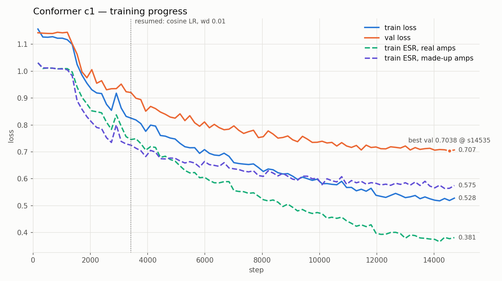

# probe_conformer c1 — results (2026-10-17)

Run: `results/encoder/encoder_probe_conformer_c1` (jobs 20992271 → 21003889, resumed at
step 3420). Launch script: `conformer_c1.sbatch`. Encoder: raw + log-mel Conformer,
1.67 M params, trained by audio loss (`esr_mrstft`) through the frozen
`delta_a2_tanh_r32_512_v2_n10` decoder. Per step: 16 real + 16 made-up amps, 84.4 s
reference crop, 2 s loss clip. 17,100 steps, ~26 h in all.

The figure was plotted while the run was at s14706 of 17100. The remaining ~2,400 steps
are flat (final val 0.7087). To redraw it with the full run:
`python scripts/plot_probe_conformer.py results/encoder/encoder_probe_conformer_c1 --resume-step 3420 --out docs/figures/probe_conformer_c1_training.png`.

**Headline: best val loss 0.7038 at s14535** (val ESR ≈ 0.63, STFT ≈ 1.44). Final
val 0.7087. `val_cos_real` 0.314, `val_cos_sim` 0.284.

## Three phases

- **s0 – ~1300: stuck at ESR ≈ 1.0.** Every curve sits at ~1.01, the "predict nothing"
  level: a near-constant embedding. c0 (2 s reference, `conformer_c0.sbatch`) never left
  this plateau in its 2,223 steps. c1 left it at ~s1300. The long reference, the 16/16 batch
  mix, or both, made it learnable. The run doesn't separate the two.
- **~1300 – ~11000: steady descent.** Val went from 1.14 to ~0.72. The restart at s3420
  (constant 1e-3 / wd 0.1 → cosine 1e-3 → 1e-5 / wd 0.01) shows no discontinuity.
- **~11000 – 17100: converged.** Val stayed between 0.704 and 0.725 while the LR decayed
  to its floor. Extending this run will not help.

## Real vs made-up amps

| at s17100 | ESR |
|---|---|
| train, real amps | **0.357**, still falling |
| train, made-up amps | **0.567**, flat since ~s11000 |
| val (unseen real amps) | **0.638** |

- Made-up amps are never reused, so their ESR measures how well the encoder handles amps
  it hasn't seen. Val tracks it closely (0.567 vs 0.638). The ~0.07 gap is the synthetic
  `TableCloud` vs real-capture domain gap, and it is small.
- Each real training amp was seen ~400 times (17,100 × 16 / 684). Their ESR falling well
  below the other two is **memorization, not skill**. Real and made-up tracked each
  other until ~s4500, then kept separating.
- So **the limit is reading an unseen amp (~0.57–0.64), not overfitting.** Overfitting
  had not hurt val yet: it kept improving until s14535.

Compared with e1 (`probe_synth`, cosine loss to table rows), which overfit early:

| | train real | train made-up | val | best step |
|---|---|---|---|---|
| e1 (cosine distance) | 0.070 | 0.559 | 0.50 | 3432 |
| c1 (ESR) | 0.357 | 0.567 | 0.638 | 14535 |

The loss values are not comparable. The best-step positions are: audio loss plus fresh
made-up amps keep c1 generalizing far longer.

## Notes

- Loss = ESR + 0.05 × STFT. Late in the run val ESR flattened at ~0.635 while val STFT kept
  falling (1.87 → 1.42): later gains came from spectral/tonal match, not the waveform.
- Val ESR ~0.64 is still far from usable. The decoder's own fitted rows reach ~0.03 on
  this metric. Using `rms_ratio ≈ sqrt(1 − ESR)` (decisions §6), that is ~4–5 dB quiet
  and poorly matched.
- `val_cos_real` 0.314 vs e1's 0.539 is expected: c1 never targets table rows, so it
  finds its own embeddings that render well. Real and generator-rendered references give
  close cosines (0.314 vs 0.284), so real-vs-generator audio isn't confusing the encoder.
- **Not yet comparable to decisions §15's "encoder alone: median test ESR 0.446".** That
  is a per-amp median; the val loss here is a pooled, amp-weighted mean (decisions §6).

## Open

1. Score it: `python -m openamp.probes.probe_esr --probe results/encoder/encoder_probe_conformer_c1/probe_conformer.pt`
   (GPU node). This decides whether c1 beats the current encoder (median 0.446), and
   whether it is a better starting point for deep-unfolded enrollment (§15).
2. A c2 should push made-up ESR (0.567) down, since val follows it. Options: a higher
   made-up share (e.g. 8 real + 24 made-up), more encoder capacity, or removing the
   ~1,300-step initial stall (warmup / higher initial LR).
